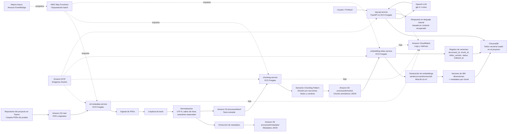

# 6. Arquitectura Completa del Pipeline

La arquitectura completa del pipeline contempla el flujo de procesamiento documental desde la ingesta de PDFs hasta la consulta RAG. El objetivo es transformar documentos funcionales de robots RPA en información consultable mediante lenguaje natural.

El flujo inicia con la carga de documentos PDF en Amazon S3, dentro del prefijo `raw/`. Luego, los microservicios del pipeline ejecutan las etapas de ingesta, limpieza, normalización, extracción de metadatos, chunking semántico, generación de embeddings e indexación vectorial. Finalmente, el servicio `rag-api-service` consulta el índice vectorial en ChromaDB y utiliza un modelo LLM de OpenAI para generar una respuesta en lenguaje natural.

En la implementación del proyecto se utilizó **Amazon S3** como almacenamiento cloud para documentos originales y artefactos intermedios, **Amazon ECS Fargate** para ejecutar los microservicios contenerizados, **Amazon ECR** como repositorio de imágenes Docker, **ChromaDB** como índice vectorial y **CloudWatch** para logs y observabilidad.

Aunque el enunciado menciona alternativas de indexación como OpenSearch, AlloyDB, BigQuery, Aurora pgvector o Azure AI Search, en este proyecto se utilizó **ChromaDB**, debido a su bajo costo, simplicidad de integración con Python y facilidad de uso para una prueba académica.

AWS Step Functions y Amazon EventBridge quedan planteados como **mejora futura** para automatizar y orquestar formalmente las etapas batch del pipeline.

---

## Diagrama Mermaid



---

## Explicación del diagrama

La primera etapa corresponde a la **ingesta documental**. Los PDDs de prueba se dejan en una carpeta del repositorio del proyecto compartido por Teams y posteriormente se cargan al bucket de Amazon S3 bajo el prefijo `raw/`. Este espacio representa la zona de entrada del pipeline y conserva los documentos originales sin modificar.

Luego, el microservicio `etl-metadata-service` ejecuta la extracción inicial. Este servicio realiza la lectura del PDF, limpieza del contenido, normalización del texto y extracción de metadatos. Como resultado, se generan archivos de texto en `processed/text/` y archivos JSON de metadatos en `processed/metadata/`.

La siguiente etapa corresponde al **chunking semántico**, implementado en `chunking-service`. Este servicio aplica el patrón **Semantic Chunking Pattern**, priorizando cortes por títulos, secciones y continuidad temática. Los chunks generados se almacenan en `processed/chunks/` como archivos JSON.

Después, `embedding-index-service` toma los chunks y genera embeddings usando el modelo open-source `sentence-transformers/all-MiniLM-L6-v2`. Cada chunk se transforma en un vector de 384 dimensiones, acompañado de metadatos como `document_id`, `chunk_id`, `index_version` y `status`.

Para la **indexación**, el proyecto utiliza **ChromaDB**. Aunque el enunciado menciona alternativas como OpenSearch, AlloyDB, BigQuery, Aurora pgvector o Azure AI Search, en nuestra implementación se seleccionó ChromaDB por su bajo costo, facilidad de integración con Python y rapidez para una prueba académica. ChromaDB almacena los embeddings y permite recuperar los chunks más similares a una pregunta del usuario.

Finalmente, `rag-api-service` expone la consulta RAG. Este servicio recibe una pregunta, consulta ChromaDB para recuperar contexto relevante, envía ese contexto al modelo `gpt-4.1-nano` de OpenAI y devuelve una respuesta en lenguaje natural.

Amazon ECR aparece en el diagrama únicamente como repositorio de imágenes Docker. ECR entrega imágenes a ECS Fargate, pero no almacena documentos, no escribe en S3 y no participa en el flujo de datos. CloudWatch centraliza los logs de cada microservicio.

EventBridge y Step Functions se muestran como mejora futura para automatizar y orquestar el batch:

```text
EventBridge -> Step Functions -> etl-metadata-service -> chunking-service -> embedding-index-service
```

El servicio `rag-api-service` no forma parte de Step Functions, porque corresponde a una consulta bajo demanda y no al procesamiento batch.
